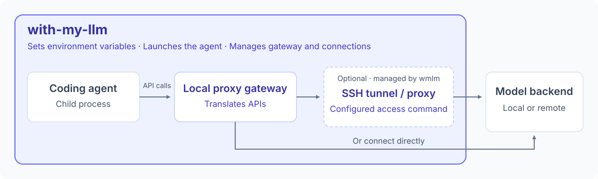

# with-my-llm

Run your preferred coding agent against a local or remote model backend. with-my-llm configures and launches the agent, translates API requests, and can set up an SSH tunnel or proxy for the session.



Configure your backends once, then choose how to work:

| What you want to do | Command | What with-my-llm handles |
| --- | --- | --- |
| Code with a local model | `wmlm opencode --backend local` | Connects the agent to your saved backend and model. |
| Try another agent on the same model | `wmlm codex --backend local` | Adapts supported API requests to the backend's protocol. |
| Use a model on a remote GPU | `wmlm opencode --backend home-gpu` | Starts the configured SSH tunnel or proxy, waits for connectivity, and cleans up on exit. |
| Try a different model for one session | `wmlm opencode --model unsloth/Qwen3.8-27B-GGUF` | Overrides the model for that run without changing your saved default. |

Supported coding agents: **Pi**, **OpenCode**, **Codex (experimental)**, and **Claude Code (experimental)**.

Codex and Claude Code integrations are still under development; some tools and workflows may fail.

`local` and `home-gpu` are example backend names you create in the configuration UI. Launch with-my-llm from the project directory you want to work in.

The command-line executable is named `wmlm` (with my LLM).

## Quick start

You need Linux or macOS, an installed coding agent, and a running model API server. Have your server's URL, model ID, and any required credentials ready. Ensure the agent is on `PATH`.

Install the latest stable release (requires `curl`, `tar`, and `sha256sum` or `shasum`):

```sh
curl -fsSL https://raw.githubusercontent.com/minitoolz/with-my-llm/main/install-wmlm.sh | sh
```

The installer supports x86_64 and ARM64, verifies the download checksum, and installs to `~/.local/bin` without sudo. Add that directory to your `PATH` if needed:

```sh
export PATH="$HOME/.local/bin:$PATH"
```

Add the same line to your shell's startup file to keep it for future terminals. To choose another installation directory, pass `WMLM_INSTALL_DIR` to `sh`:

```sh
curl -fsSL https://raw.githubusercontent.com/minitoolz/with-my-llm/main/install-wmlm.sh | WMLM_INSTALL_DIR="$HOME/bin" sh
```

Alternatively, build from a checkout of this repository with Rust 1.86 or newer using `cargo install --locked --path .`, and ensure Cargo's bin directory (usually `~/.cargo/bin`) is on `PATH`.

Open the configuration UI:

```sh
wmlm cfg
```

Choose **Add backend**, give it a name such as `local`, and enter its connection details:

- **URL:** the API base URL, such as `http://127.0.0.1:8000/v1`.
- **Protocol:** OpenAI Chat Completions, OpenAI Responses, or Anthropic Messages, matching your backend.
- **Model:** the exact model ID advertised by your backend, including any namespace.
- **Authentication:** a bearer token, HTTP Basic credentials, or none, as required by your backend.

Choose **Direct** for **Backend access** if the server is already reachable. For a remote server that needs a tunnel, follow [SSH tunnels and proxies](#ssh-tunnels-and-proxies).

Choose **Bind agent**, select your agent and backend, then **Exit**. From your project directory, start the agent:

```sh
wmlm opencode
```

Replace `opencode` with `pi`, `codex`, or `claude` to launch another agent. Forward agent options after `--`:

```sh
wmlm claude -- --continue
```

### Inspecting or bypassing automatic arguments

wmlm normally adds the arguments needed to connect your agent to the selected backend. To see those arguments without launching the agent or connecting to the backend:

```sh
wmlm opencode -arg
wmlm opencode -arg -- serve
```

`-arg` (also `--arg`) prints a JSON array of the automatically added arguments. For OpenCode, it checks the installed CLI's help for `--standalone` support. Other agents use your selected backend configuration; values only known at launch appear as `<bridge-url>`, `<discovered-model>`, or `<temporary-extension>`.

Use `-x` (also `--no-auto-args`) to disable all automatic arguments for one launch:

```sh
wmlm opencode -x -- serve
wmlm opencode -arg -x -- serve  # prints []
```

Put these wmlm options before `--`. Everything after `--` remains an agent argument, including any flags you explicitly supply. `-x` keeps the backend environment configuration, but bypasses OpenCode's help check and automatic `--standalone`. For other agents it also removes automatic model, provider, settings, and extension arguments; you may need to supply those yourself to use the intended backend.

When adding `--standalone`, wmlm warns about known OpenCode conflicts such as `serve`, `service`, `plugin add/remove`, `mcp add`, or `--server`. The warning does not stop execution or remove the argument. Detection is best-effort and depends on argument layout; no warning does not guarantee compatibility with your OpenCode version.

## Updating

Check for a newer stable release or install it:

```sh
wmlm update --check
wmlm update
```

Updates come from [minitoolz/with-my-llm GitHub Releases](https://github.com/minitoolz/with-my-llm/releases). Linux and macOS are supported on x86_64 and ARM64. The updater installs newer stable releases only and preserves your configuration and credentials. If an update fails, your existing executable remains available.

The installation directory must be writable. If you installed through a package manager, update through that package manager.

`--check` checks release availability without installing anything. Updates run only when you request them.

## Configuration

Run `wmlm cfg` to edit backends, agent defaults, credentials, and web-search settings. After adding or editing a backend, you can test the connection before it is saved. The test starts any configured access command, requests the authenticated model list, displays available models, and cleans up the access session. It does not generate a completion. A failed test reports the error but still saves your settings so you can edit them later.

### Configure from the command line

Run `wmlm cfg` to open the TUI, or use its subcommands without an interactive terminal. `wmlm cfg --help` lists the commands, and each command has its own `--help`. `--config PATH` works at any level.

```sh
wmlm cfg show
wmlm cfg backend add local --url http://localhost:8000/v1 --protocol chat_completions
wmlm cfg backend edit local --model my-model
wmlm cfg bind opencode local
wmlm cfg bind claude local --model another-model
wmlm cfg ports '3000, 8000-8010'
wmlm cfg backend test local
```

`show` prints JSON with authentication credentials and search API keys redacted. Use `show --show-secrets` only when you need the actual values. Access and cleanup command strings are displayed as saved, so avoid embedding credentials in them. Changes print a JSON `saved` path; connection tests print the backend name and model list. Access-command output and errors go to stderr; errors return a nonzero exit status.

Backend protocols are `chat_completions`, `responses`, and `anthropic`. Adding a backend requires `--url` and `--protocol`; editing preserves every omitted field, including credentials. Use `--clear-model` for model discovery, `--clear-auth` to remove authentication, or `--direct` to remove the access command. `cfg bind` without `--model` uses the backend default. `cfg unbind AGENT` removes a binding; `cfg backend delete NAME` deletes that backend and all its agent bindings.

To configure authentication, pass `--auth-file PATH` to `backend add` or `backend edit`. The file contains one of these JSON objects (replace the example values); `--auth-file -` reads it from stdin:

```json
{"type":"bearer","token":"YOUR_TOKEN"}
```

```json
{"type":"basic","username":"YOUR_USERNAME","password":"YOUR_PASSWORD"}
```

Configure an SSH tunnel or another access command with the same controls available in the TUI:

```sh
wmlm cfg backend edit remote \
  --access-command 'ssh -N -L 18000:localhost:8000 gpu-host' \
  --persistent true --timeout-secs 30 --health-check-interval-secs 30
wmlm cfg backend edit remote --cleanup 'your-cleanup-command'
wmlm cfg backend edit remote --clear-cleanup
```

New access commands default to preparation-only (`--persistent false`), a 30-second readiness timeout, and a 30-second health check interval. Set the interval to `0` to disable health checks. Editing an existing command preserves its other settings. Saving does not run the command or contact the backend; `cfg backend test NAME` explicitly tests the saved configuration and runs its access/cleanup commands. A failed test leaves settings unchanged.

Select web search with one of:

```sh
wmlm cfg web-search public
wmlm cfg web-search searxng --url http://localhost:8080
wmlm cfg web-search brave --api-key-file /path/to/brave-key
```

The Brave key file is plain text; `-` reads stdin. One trailing line ending is removed. Omit `--api-key-file` to retain an already configured Brave key.

### Configuration defaults

A model supplied with `--model` overrides the agent's saved model, which overrides the backend's default.

Use `{PORT}` to choose an available local port automatically. For example, pair the backend URL `http://127.0.0.1:{PORT}/v1` with the access command `ssh -N -L {PORT}:localhost:8000 user@host`. The same port is used throughout the session, including reconnection and cleanup.

Set **Random port candidates** in `wmlm cfg` to change the default range, `1024-65535`. You can enter individual ports, ranges, or a combination such as `3000, 8000-8100, 9000`. If no candidate is available, the launch stops with an error. This checks ports on your machine, not on the remote server.

Leave both model fields blank to select the first model advertised by your backend. OpenCode and Pi also let you choose from the discovered models during the session. Restart with-my-llm to refresh the available models.

If discovery fails or returns no models, the agent will not launch. Set `--model MODEL` for servers without a model-list endpoint.

Using a local model through with-my-llm leaves your ordinary Codex model default unchanged. Your existing Codex sessions and skills remain accessible, but model and settings changes made inside a with-my-llm-launched Codex session are discarded on exit. To change your usual Codex defaults, launch Codex directly.

If upgrading from codeport, copy your existing `~/.config/codeport/credential.json` to `~/.config/wmlm/credential.json`, keeping its restricted file permissions, or use `wmlm --config ~/.config/codeport/credential.json` followed by your usual arguments.

Configuration and credentials are stored in `~/.config/wmlm/credential.json`. Credentials are plaintext, protected by restricted file permissions. To use a separate configuration:

```sh
wmlm cfg --config ./credential.json
wmlm --config ./credential.json opencode
```

## SSH tunnels and proxies

with-my-llm can start a connection command before launching your agent and stop it when the session ends. For a backend already reachable from your machine, choose **Direct** under **Backend access**.

For example, to reach a model server listening on port `8000` on an SSH host named `home-gpu`, edit the backend in `wmlm cfg`:

1. Set the backend URL to `http://127.0.0.1:18000/v1`.
2. Choose **Command** under **Backend access** and enter:

   ```sh
   ssh -N -o BatchMode=yes -o ExitOnForwardFailure=yes -L 127.0.0.1:18000:127.0.0.1:8000 home-gpu
   ```

3. Choose **Stay running during the agent session** for the command lifecycle.
4. Save the backend, then launch with `wmlm opencode --backend home-gpu`.

Replace `home-gpu` and the ports with your own connection details. SSH must be installed and able to authenticate without a password prompt. with-my-llm waits for the local port to become reachable before launching the agent. After launch, an unexpected tunnel exit triggers reconnection while the agent stays running.

You can configure a proxy or another access utility the same way. Install and authenticate it beforehand; access commands cannot prompt for input. Commands that only prepare a connection can use **Finish before launching the agent**, with an optional cleanup command to stop any background service they start.

with-my-llm automatically reconnects when a managed connection fails and keeps the coding agent running during recovery. An in-flight model request may still fail. When the agent exits, with-my-llm stops the managed connection and its child processes. Separately started tunnels must be managed yourself.

For backends with an access command, with-my-llm also checks the model-list API every 30 seconds and restarts the connection if the check fails.

Set **API health check interval in seconds** in `wmlm cfg`, or set `health_check_interval_secs` in the backend's `access` configuration:

```json
"access": {
  "command": "ssh -N -L 8000:localhost:8000 server",
  "persistent": true,
  "timeout_secs": 30,
  "health_check_interval_secs": 30,
  "cleanup": null
}
```

Use `0` to disable API polling, including for backends that do not support the model-list endpoint. Persistent commands are still restarted when their process exits. Health checks do not generate completions or verify model inference.


## Web search for Claude Code

Claude's built-in `WebSearch` works with public DuckDuckGo search by default when using a Chat Completions or Responses backend. No search API key is needed. Native Anthropic backends keep their own search service.

To change providers, open `wmlm cfg` → **Configure web search**:

- **Public:** DuckDuckGo, with no setup or API key.
- **SearXNG:** enter your instance's base URL and enable JSON results in its `search.formats` setting.
- **Brave:** enter your Brave Search API key.

Search queries go to the selected provider directly, without using the model backend's SSH tunnel or proxy. Public search may encounter rate limits or bot challenges; with-my-llm reports failures without switching providers automatically.

with-my-llm enables Claude's built-in `WebFetch` across domains for the session. Explicit deny rules and managed policies still apply. Websites may reject requests, require login, or depend on JavaScript, so some pages cannot be fetched.

## Compatibility and limitations

Codex and Claude Code support is experimental. Text conversations and tool calls are supported across API protocols, but some agent features require a matching backend protocol:

- **Codex:** reasoning and hosted web search are disabled when translating to another protocol.
- **Claude Code:** extended thinking and explicit reasoning effort are disabled when translating to another protocol.
- **Images and other advanced features:** may be unavailable during protocol translation.

Claude auto mode is available with Chat Completions and Responses backends:

```sh
wmlm claude -- --permission-mode auto
```

with-my-llm uses your configured model to review proposed actions, so permission decisions depend on that model and may add latency. Native web searches and fetches are automatically allowed by with-my-llm's reviewer; other actions remain blocked if their review fails. This review differs from Anthropic's own classifier.

Codex defaults to a 32,768-token context window. If your backend supports a different size, set it explicitly:

```sh
wmlm codex -- -c model_context_window=65536
```

## Troubleshooting

- **Agent or `wmlm` not found:** check that the executable is installed and on `PATH`.
- **401 Unauthorized:** update the backend's credentials with `wmlm cfg`.
- **Model not found:** check the exact model ID, including its namespace, and confirm the server has loaded it.
- **Connection timeout:** check the backend URL, server availability, and any SSH or proxy command. A reachable port alone does not confirm valid credentials or a loaded model.
- **Agent stops after a connection loss:** managed access recovery reports `backend access restored` when ready. Agent exits report their exit code or terminating signal; SIGTERM and SIGINT received by with-my-llm are reported separately. The launcher exits when the agent exits; an in-flight model request can fail during recovery. With **Direct** access, restart separately launched tunnels yourself or configure a managed access command.
- **WebFetch blocked or rejected:** restart with-my-llm after updating it. Website errors such as HTTP 402 or 403 can still prevent fetching even when with-my-llm allows the request.

## Contributing

For development checks, release instructions, and implementation notes, see [CONTRIBUTING.md](CONTRIBUTING.md).
